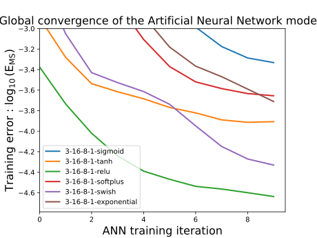

An artificial neural network (ANN) surrogate model for the **flow stress of metals during thermocompression (hot compression) testing**. The network is trained on flow stress data and then exported to **Fortran**, so the trained model can be called directly from numerical simulation code (e.g. as a constitutive / flow stress routine) without a Python runtime.

---

## Table of Contents

- [Overview](#overview)
- [Repository Structure](#repository-structure)
- [Workflow](#workflow)
- [Getting Started](#getting-started)
- [Usage](#usage)
- [Data](#data)
- [Using the Fortran Model](#using-the-fortran-model)
- [Results](#results)
- [Contributing](#contributing)
- [License](#license)
- [Contact](#contact)

---

## Overview

In thermocompression experiments, a specimen is compressed at a controlled temperature and strain rate, and the resulting flow stress is recorded as a function of strain. Flow stress depends non-linearly on strain, strain rate and temperature, and classical constitutive equations (Arrhenius, Johnson-Cook, etc.) can struggle to capture the full behaviour across wide processing windows.

This project replaces such an equation with a feed-forward ANN that:

1. **Learns** the mapping from process variables (typically strain, strain rate, temperature) to flow stress from tabulated data.
2. **Exports** the trained weights and architecture as Fortran source, ready to be compiled into finite element or other simulation codes.

## Repository Structure

```
thermocompression_ANN/
├── basic_initialization.ipynb      # Environment setup and data loading / preprocessing
├── ANN_training.ipynb              # Model definition, training and evaluation
├── Fortran_generation.ipynb        # Converts the trained model into Fortran code
├── flow_stress_table(31).txt       # Flow stress dataset (coarse table)
├── flow_stress_table(601).txt      # Flow stress dataset (fine table)
├── convergence.svg                 # Training convergence plot
├── trained_models/                 # Saved trained ANN models
├── trained_fortran/                # Generated Fortran source for the trained models
└── README.md
```

| Item | Description |
| --- | --- |
| `basic_initialization.ipynb` | Basic setup: imports, data loading and preprocessing. |
| `ANN_training.ipynb` | Builds, trains and evaluates the ANN. |
| `Fortran_generation.ipynb` | Writes the trained network out as Fortran subroutines. |
| `flow_stress_table(31).txt`, `flow_stress_table(601).txt` | Flow stress tables, apparently at two resolutions (31 and 601 points per curve/axis). |
| `convergence.svg` | Loss convergence during training. |
| `trained_models/` | Trained model files for reuse without retraining. |
| `trained_fortran/` | Fortran output of the generation notebook. |

## Workflow

```
flow stress tables ──► basic_initialization ──► ANN_training ──► trained_models/
                                                                      │
                                                                      ▼
                                                           Fortran_generation
                                                                      │
                                                                      ▼
                                                              trained_fortran/
```

1. **Initialise** the data and environment (`basic_initialization.ipynb`).
2. **Train** the ANN and inspect convergence (`ANN_training.ipynb`).
3. **Generate** Fortran code from the trained model (`Fortran_generation.ipynb`).

## Getting Started

### Prerequisites

- Python 3.8+
- Jupyter Notebook or JupyterLab
- A deep learning / numerical stack, e.g. NumPy, pandas, Matplotlib and TensorFlow/Keras or PyTorch (see the imports at the top of `ANN_training.ipynb` for the exact packages)
- A Fortran compiler (e.g. `gfortran`, Intel `ifx`) to build the generated code

### Installation

```bash
git clone https://github.com/XWE-kumo/thermocompression_ANN.git
cd thermocompression_ANN

# Recommended: use a virtual environment
python -m venv venv
source venv/bin/activate        # Windows: venv\Scripts\activate

pip install numpy pandas matplotlib jupyter
# plus your deep learning framework of choice, as used in ANN_training.ipynb
```

## Usage

Launch Jupyter and run the notebooks in order:

```bash
jupyter notebook
```

1. **`basic_initialization.ipynb`**: run first to load and prepare the flow stress data.
2. **`ANN_training.ipynb`**: trains the network. Training progress is summarised in `convergence.svg`.
3. **`Fortran_generation.ipynb`**: exports the trained network to `trained_fortran/`.

If you only want the pre-trained results, skip straight to `trained_models/` or `trained_fortran/`.

## Data

The `flow_stress_table(*).txt` files contain tabulated flow stress values from thermocompression tests, used as the training data.

> **Note:** Document the column layout, units (e.g. °C or K, s⁻¹, MPa), material/alloy and data source here so that results are reproducible.

## Using the Fortran Model

The files in `trained_fortran/` implement the trained ANN as plain Fortran, so they can be compiled together with a host program or solver.

```bash
# Example: compile the generated routine together with your own driver
gfortran -O2 trained_fortran/<generated_file>.f90 your_driver.f90 -o ann_flow_stress
```

> Replace `<generated_file>` and `your_driver` with the actual filenames. The routine takes the process variables as input (in the same order and normalisation used during training) and returns the predicted flow stress.

**Important:** inputs must be scaled the same way as during training. Check the normalisation applied in `ANN_training.ipynb` and make sure the Fortran code (or your calling code) applies it identically.

## Results

Training convergence:



> Add key metrics here (e.g. R², RMSE, mean relative error on a held-out test set) and a plot comparing predicted vs. experimental flow stress curves.

## Contributing

Contributions, bug reports and suggestions are welcome.

1. Fork the repository
2. Create a feature branch (`git checkout -b feature/my-change`)
3. Commit your changes
4. Open a pull request

## License

No license has been specified yet. Add a `LICENSE` file (e.g. MIT, Apache-2.0) to clarify how others may use this work.

## Contact

Maintained by [XWE-kumo](https://github.com/XWE-kumo). Please open an [issue](https://github.com/XWE-kumo/thermocompression_ANN/issues) for questions or problems.